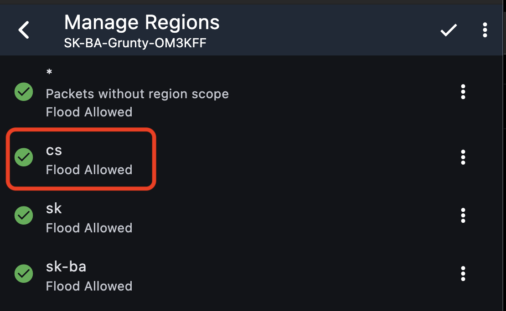

## Pridanie regiónu `cs` na repeatre

Vďaka OM2AMT máme rozbehnutú testovaciu prevádzku bridge SK ⇄ CZ, momentálne na kanáli `#cs`.

Okrem kanálov by sme chceli povoliť aj súkromné správy a ďalšiu komunikáciu. To bude možné až vtedy, keď bude mať región `cs` pridaný väčšina repeatrov na Slovensku aj v Česku. V Bratislave je už pridaný na väčšine repeatrov.

> **Prosíme správcov repeatrov: pridajte na svoje repeatre región `cs`.**



Možte tiež použiť príkazový riadok:
```
region put cs
region save
```

### Ako to bude fungovať

Keď budú mať región `cs` nastavený všetky repeatre:

1. V klientovi nastavte **Predvolený región** na `cs`.
2. Pošlite **flood advert**. Dorazí až do Česka.
3. Keď to isté urobí váš partner v Česku, môžete si písať súkromné správy, akoby ste boli v jednej sieti.